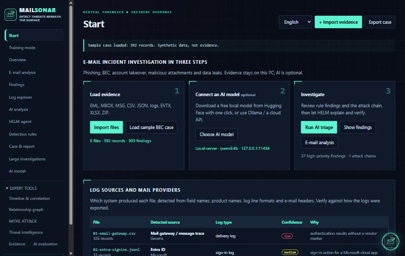
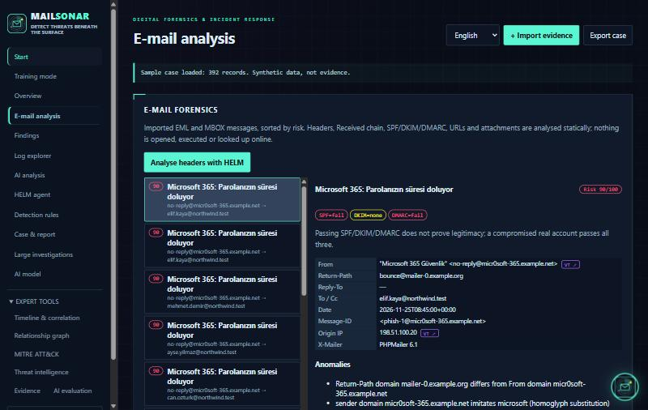
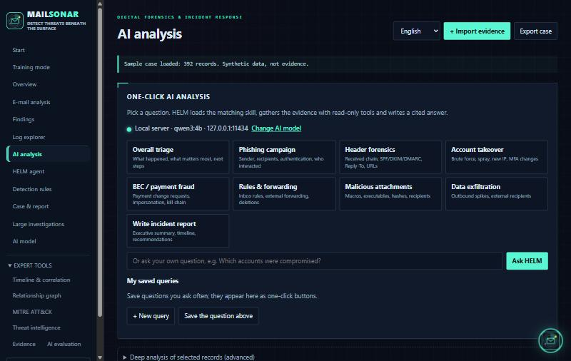
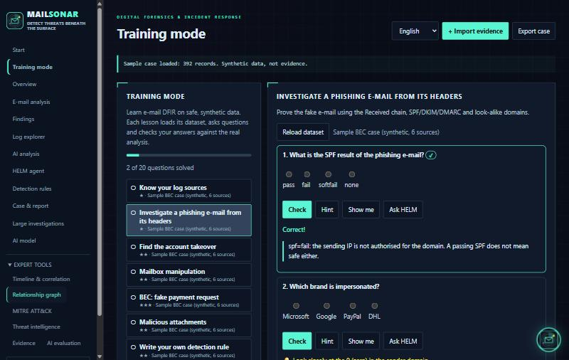
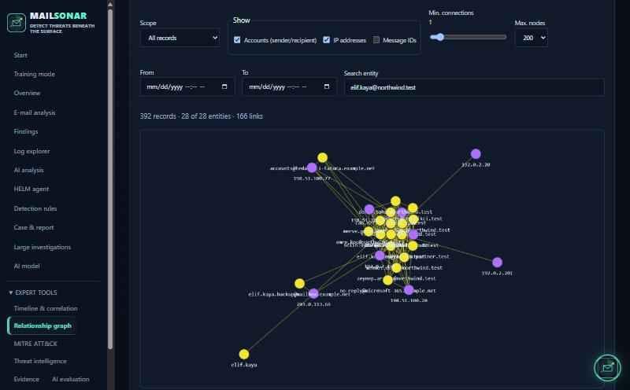
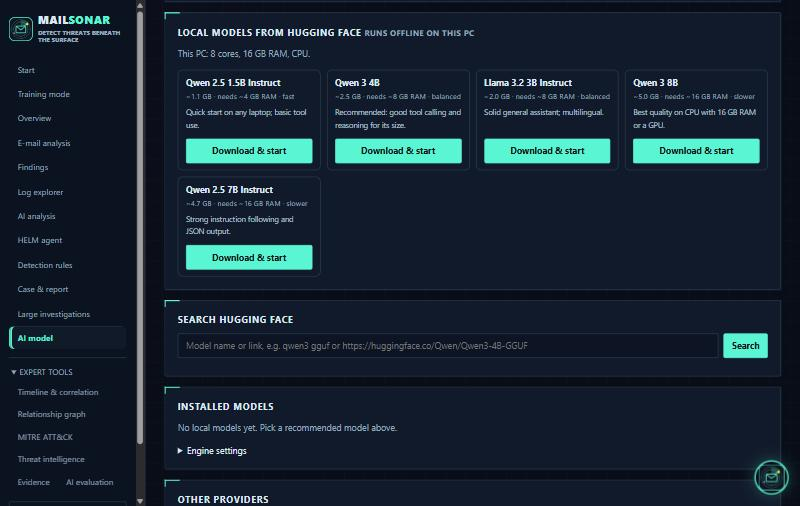

# MailSonar — V1.3

**Detect threats beneath the surface.** · 🇹🇷 [Türkçe README](README.tr.md)

[](https://github.com/smyrna-pergamum/mailsonar/releases/latest)




MailSonar is a local-first e-mail forensics and incident-response workbench (Rust + Tauri 2, vanilla JS UI). It investigates phishing, business e-mail compromise (BEC), account takeover, malicious attachments and data exfiltration from mail-gateway, identity, mailbox-audit, MTA and message evidence. Deterministic parsing, detection and correlation work without AI; the **HELM** agent adds evidence-cited AI analysis with local Hugging Face models or any OpenAI-compatible provider.

> **Status:** source builds and all tests pass on Windows; Windows, Linux and macOS installers are built by GitHub Actions. Not independently validated as a forensic product. See `TEST-RESULTS.md`, `SECURITY-AUDIT.md` and `AI-EVALUATION.md`.

## Download

Latest release: **[v1.3.0](https://github.com/smyrna-pergamum/mailsonar/releases/latest)** (all releases: [Releases](https://github.com/smyrna-pergamum/mailsonar/releases)).

| System | Download |
|---|---|
| Windows 10/11 x64 | [Installer (.exe)](https://github.com/smyrna-pergamum/mailsonar/releases/download/v1.3.0/MailSonar_1.3.0_x64-setup.exe) · [MSI](https://github.com/smyrna-pergamum/mailsonar/releases/download/v1.3.0/MailSonar_1.3.0_x64_en-US.msi) |
| Linux x64 | [AppImage](https://github.com/smyrna-pergamum/mailsonar/releases/download/v1.3.0/MailSonar_1.3.0_amd64.AppImage) · [.deb](https://github.com/smyrna-pergamum/mailsonar/releases/download/v1.3.0/MailSonar_1.3.0_amd64.deb) · [.rpm](https://github.com/smyrna-pergamum/mailsonar/releases/download/v1.3.0/MailSonar-1.3.0-1.x86_64.rpm) |
| macOS Apple Silicon | [.dmg](https://github.com/smyrna-pergamum/mailsonar/releases/download/v1.3.0/MailSonar_1.3.0_aarch64.dmg) |
| macOS Intel | [.dmg](https://github.com/smyrna-pergamum/mailsonar/releases/download/v1.3.0/MailSonar_1.3.0_x64.dmg) |

All features below, including large investigations, graph filters, VirusTotal links and the deep analysis redesign, are in this release.

Builds are not code-signed. macOS: `xattr -dr com.apple.quarantine /Applications/MailSonar.app` once. Windows SmartScreen: *More info → Run anyway*. Every build bundles the CPU build of the llama.cpp engine; AI models are downloaded inside the app.

## Quick start

1. **Start** → *Load sample BEC case* (synthetic) or *Import files*.
2. **AI model** (optional) → use a model *Found on this PC* (running Ollama, LM Studio, llama.cpp, vLLM, Jan… or a GGUF file on disk) or *Download & start* a recommended Hugging Face model. *Test connection* measures chat, speed and tool calling.
3. **AI analysis** → one-click questions or your own saved queries. **E-mail analysis** → headers, Received chain, SPF/DKIM/DMARC, URLs, attachments. **Detection rules** → describe a rule in plain language.
4. **Training mode** → guided lessons with answer checking on bundled datasets.

### Hızlı başlangıç (Türkçe)

1. **Başla** → *Örnek BEC vakasını yükle* veya *Dosya içe aktar*.
2. **AI modeli** (isteğe bağlı) → *Bu bilgisayarda bulunanlar* listesinden bir model seçin ya da önerilen bir Hugging Face modelini *İndir ve başlat*. *Bağlantıyı test et* sohbet, hız ve araç çağırmayı ölçer.
3. **AI analizi** → tek tıkla sorular veya kaydettiğiniz kendi sorgularınız. **E-posta analizi** → başlıklar, Received zinciri, SPF/DKIM/DMARC, URL'ler ve ekler. **Tespit kuralları** → kuralı doğal dille tarif edin.
4. **Eğitim modu** → örnek veri setleri üzerinde cevap kontrollü, adım adım dersler.

The UI is available in English, German and Turkish and switches live from the language menu.

## Screenshots

| | |
|---|---|
|  **E-mail analysis** — risk-sorted messages, SPF/DKIM/DMARC, Received chain, look-alike domains, VirusTotal links |  **AI analysis** — one-click HELM profiles, free questions, saved queries |
|  **Training mode** — lessons with answer checking on bundled datasets |  **Relationship graph** — filters for scope, entity type, time, connections and search |
|  **AI model** — local discovery, self-test, one-click Hugging Face models | |

Screenshots show the synthetic sample case in the browser preview.

## Screens

| View | What it does |
|---|---|
| **Start** | Three steps (evidence → AI model → investigate), log sources and mail providers, attack chains |
| **Training mode** | 9 lessons, 20 questions on the synthetic BEC case and the repository dataset; hints, "show me", explanations, progress |
| **Overview / Findings / Log explorer** | Dashboards, rule findings with analyst review, paged record browser |
| **E-mail analysis** | Messages sorted by risk with header, authentication, Received-chain, URL, attachment and platform analysis |
| **AI analysis** | Nine one-click investigation profiles (each a HELM skill), free questions, **saved analyst queries** and a guided *deep analysis* of chosen records (selected, batched, two-stage) |
| **HELM agent** | Agent console with live plan and tool trace, skill library, WAYPOINT workflows, sessions |
| **Detection rules** | AI rule writer (tests each rule against the case), quick rule form, JSON/Sigma/mapping editors |
| **Case & report** | Save/open cases, HTML/PDF/JSON/OCSF and relationship-graph export |
| **Large investigations** | Streamed multi-million-event cases with checkpoints, cross-batch correlation and HELM |
| **AI model** | Local discovery and self-test, Hugging Face hub, installed models, other providers |
| **Expert tools** | Timeline, relationship graph with filters (scope, entity types, time range, min. connections, search), MITRE ATT&CK, threat intelligence, evidence vault, AI evaluation |

## E-mail forensics

- **Import:** EML, MBOX, MSG, CSV, JSON, JSONL, XML, TXT, LOG, EVTX, XLSX, ZIP, GZIP.
- **Message analysis (static, nothing executed, rendered or fetched):** Received chain bottom-up with origin IP, unknown relays and time-order anomalies; SPF/DKIM/DMARC; From vs Return-Path vs Reply-To vs display name; look-alike domains (homoglyphs, typosquatting, brand keywords); URLs (visible text vs target, punycode, shorteners, IP literals, open redirects); attachments (SHA-256, magic-byte type, double extension, RTL override, macros, encrypted ZIP).
- **Log source and mail-provider identification:** every file is fingerprinted from field names, product names, line formats and headers — Microsoft 365 unified audit log, Exchange Online message trace, Entra ID sign-ins, Exchange Server message tracking, Google Workspace, Postfix, Exim, Sendmail, Dovecot, Rspamd, Amavis, Proofpoint, Mimecast, Cisco Secure Email, Barracuda, Zimbra, Amazon SES. Messages show sending, relay, gateway and receiving platforms (Microsoft 365, Gmail, SES, SendGrid, Mailgun, Proofpoint, Mimecast, GMX/WEB.DE, IONOS…). Each attribution carries a confidence and the reason.
- **Manual reputation check:** every URL, domain, origin IP and attachment hash has a *VT ↗* link that opens VirusTotal in your browser (nothing is queried automatically; a one-time notice explains that VirusTotal is a third party).
- **Detection:** 30 built-in rules (MAIL-001…030), custom rules, Sigma subset, IOC matching, anomaly rule.
- **Correlation:** COR-001 authentication-failure window, COR-002 outbound spike, COR-003 message trace, **COR-004 kill chain** per account (phishing received → suspicious sign-in → mailbox manipulation → fraud/exfiltration within 24 h).
- **Evidence handling:** SHA-256 verified, SQLite vault, hash-chained journal. Not encrypted, not externally anchored.

## Large investigations (millions of events)

The in-memory workspace holds up to **100,000 records**. Larger evidence goes to a **Large investigation**: a per-case SQLite store on disk.

- **Streaming ingest:** CSV, JSONL/NDJSON, LOG/TXT and MBOX are read line by line, also inside GZIP and ZIP; EML, JSON arrays, EVTX, XLSX and XML are parsed in memory up to 256 MiB each.
- **Chunked processing:** adaptive batches of 2,000–20,000 records (by free RAM), 1–4 parallel workers with bounded queues (backpressure), an ordered writer and a per-batch checkpoint. The 20,000 guard limits a batch, not the investigation.
- **Fault tolerance:** a stopped or crashed import resumes from the checkpoint when the same file (same SHA-256) is added again; identical events are stored once (content hash); malformed records are kept in a failures table with their record number.
- **Global correlation:** after import, COR-001/002/003 and the COR-004 kill chain run across all batches and files, so a phishing mail in batch 1 and a forwarding rule in batch 40 still connect.
- **Analysis:** overview (severities, top entities, hourly activity), paged findings and records with field or full-text search, log-source profiles per file, **HELM on the whole store** (SQL-backed tools, minimized for cloud providers) and *copy results to workspace* for the in-memory tools.
- **Benchmark:** `cargo test --release --manifest-path src-tauri/Cargo.toml bench_ingest_scales -- --ignored --nocapture` measures 1k … 1M events (EPS, batch latency P50/P95/P99, peak RAM, duplicates, failures, integrity, crash recovery). Results: `PERFORMANCE-BENCHMARKS.md`.

## HELM agent and skills

HELM plans with `update_plan`, investigates with read-only tools, loads skills and cites evidence IDs. Tools: list/filter/search/aggregate events, trace e-mail, timeline, network graph, findings, severity and MITRE summaries, IOC matches, evidence inspection, **log sources**, **test_rule**, case summary, report draft (approval required), **list_skills / load_skill**.

**Skills** are Markdown playbooks in the style of Claude Code, Codex and OpenCode skills:

```markdown
---
name: phishing-triage
description: When HELM should use this skill
triggers: phishing, oltalama, spoof
preload:
  - findings {"severity": "high", "limit": 25}
---
# Playbook: steps and answer format
```

- 10 built-in skills: triage, phishing-triage, email-header-forensics, malware-delivery, account-takeover, mailbox-rule-abuse, bec-fraud, data-exfiltration, detection-engineering, incident-report.
- Add your own in the **Skills** tab: write one, duplicate and edit a built-in, or **import `.md` files**. They are stored in `<app data>/skills/` and override built-ins of the same name.
- Start a message with `/skill-name` to force a skill; otherwise HELM routes by triggers and can load skills itself. Preload tools run in the backend before the first model turn, so small local models start grounded.
- Works with native function calling or a text tool protocol (`<tool_call>{…}</tool_call>`) for models without it; follow-up questions keep bounded history (local providers only); steps stream live.
- Skills cannot add tools, widen permissions or bypass minimization.

## Local AI

- **Found on this PC:** probes loopback ports of Ollama, LM Studio, llama.cpp, vLLM, KoboldCpp, text-generation-webui, Jan, GPT4All and LocalAI; scans LM Studio, Hugging Face cache, Jan, GPT4All, `~/models` and Downloads for GGUF files.
- **Self-test:** synthetic prompts only; reports chat, latency, tokens/s, native or text tool calling and HELM readiness.
- **Hugging Face:** recommended models with one-click *Download & start* (single-file Q4_K_M chosen from the listing, SHA-256 verified when published), search or paste a repository link.
- **Bundled engine:** llama.cpp `llama-server` CPU build started on loopback with a per-run key and `--jinja`. Measured on an 8-core laptop CPU with Qwen3-4B Q4_K_M: ~3.5 tokens/s, 1–9 minutes per agent turn. Use a GPU build, a smaller model or an external server for interactive speed.

## AI privacy model

- One AI connection is shared by all features. Loopback providers keep everything on the device and need no per-run checkbox; remote providers require a per-run confirmation naming the host.
- For remote providers the backend replaces sender, recipient, IP and message ID with `entity-N` aliases, removes raw record data and source names, withholds IOC values and finding details, and does not forward conversation history.
- This is pseudonymization, not anonymization. Questions and notes are sent as typed. API keys stay in memory only.

## Limits

- In-memory workspace: 100,000 records and 64 MiB per file; larger evidence uses Large investigations (SQLite on this PC; no distributed cluster).
- MSG: selected MAPI properties only. Attachments are hashed and inspected statically; there is no sandbox, AV or reputation lookup.
- Provider identification is heuristic; renamed or re-exported logs can look like another product.
- HELM is a bounded single-agent loop; AI output is unverified and requires analyst review.
- Linux and macOS builds come from CI and have not been manually tested.

## Build from source

Prerequisites: Rust stable, Node.js 22+, Tauri 2 platform prerequisites (Windows: VS C++ Build Tools + WebView2; Linux: `libwebkit2gtk-4.1-dev libappindicator3-dev librsvg2-dev patchelf`).

```sh
npm install
npm test
cargo test --manifest-path src-tauri/Cargo.toml
npm run tauri dev      # development
npm run tauri build    # installers in src-tauri/target/release/bundle
```

The browser preview (`npm run dev`) serves the real parser output of the sample datasets from `tests/fixtures` (regenerate with `cargo test --manifest-path src-tauri/Cargo.toml demo_write_preview_fixture -- --ignored`). It performs no inference.

End-to-end test with a real model:

```powershell
$env:MAILDFIR_TEST_GGUF = "C:\path\to\model.gguf"
cargo test --manifest-path src-tauri/Cargo.toml demo_helm_with_real_model -- --ignored --nocapture
```

## Releases (GitHub Actions)

`.github/workflows/release.yml` builds Windows x64, Linux x64, macOS arm64 and macOS x64 with `tauri-apps/tauri-action`, bundles the matching llama.cpp engine and uploads the installers to a **draft** release. Trigger it by pushing a tag (`git tag v1.4.0 && git push origin v1.4.0`) or from *Actions → Release → Run workflow*. `.github/workflows/ci.yml` runs tests, clippy and a Windows build on every push.

## Project layout

```
src/                    UI (vanilla JS): main.js, ui/ (start, training, e-mail view, AI, rules, model hub,
                        skills, large investigations, graph filters)
src-tauri/src/          Rust backend: parsing, email.rs, sources.rs, agent.rs (HELM), skills.rs,
                        local_ai.rs, embedded_ai.rs, inv_*.rs (large investigations), lookup.rs,
                        samples.rs, queries.rs, workflow.rs, vault.rs
src-tauri/skills/       Built-in HELM skills (Markdown)
samples/demo/           Synthetic BEC case (dataset/generators/demo_scenario.py)
dataset/                Labelled multi-source dataset, generators and ground truth
docs/screenshots/       README screenshots
tests/                  Node and Python tests, preview fixtures
```

## Documentation

`CHANGELOG.md` · `ROADMAP.md` · `TEST-RESULTS.md` · `SECURITY-AUDIT.md` · `AUDIT.md` · `AI-EVALUATION.md` · `AI-QUALITY-GATES.md` · `MODEL-BENCHMARKS.md` · `PERFORMANCE-BENCHMARKS.md` · `DATASET-MANIFEST.md` · `TRACEABILITY.md` · `THIRD-PARTY-NOTICES.md`

The application identifier `org.maildfir.desktop`, storage paths and case schema IDs keep their historical names so existing installations upgrade in place.

## Optional integrations

```sh
python -m venv .venv
pip install -r integrations/requirements.txt
python integrations/worker.py sigma rule.yml
python integrations/worker.py pdf case.json --output report.pdf
```

`integrations/` contains pySigma execution, LogAI feature preparation and MISP/TAXII fetching (mock-tested only).

## License

See `LICENSE` and `THIRD-PARTY-NOTICES.md`.
