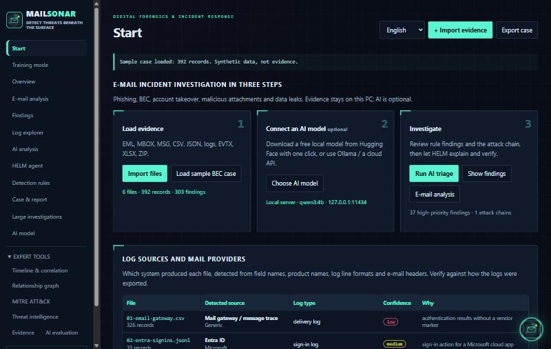
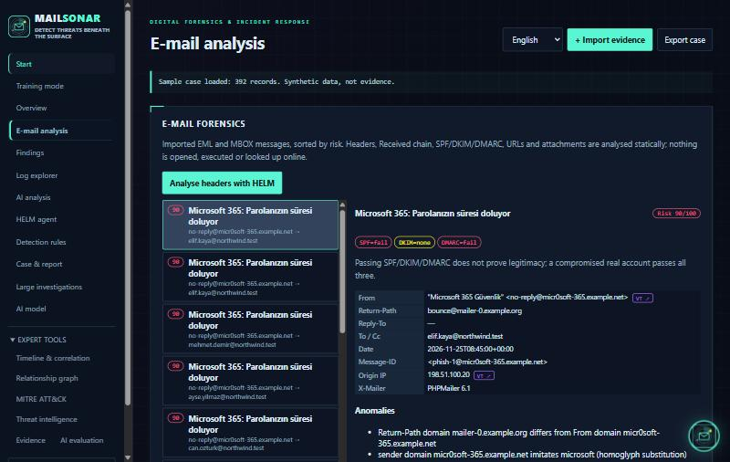
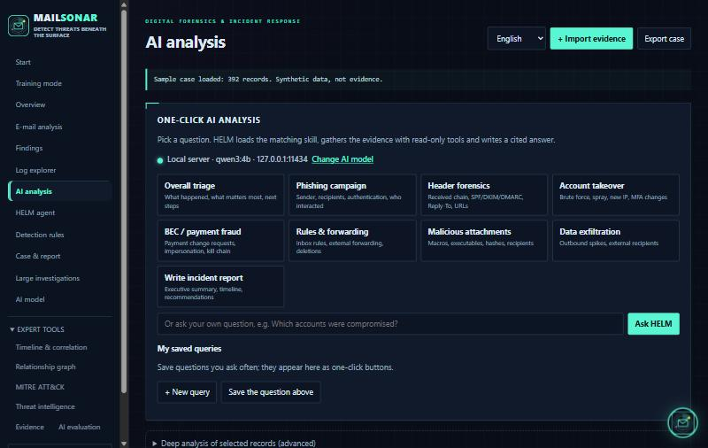
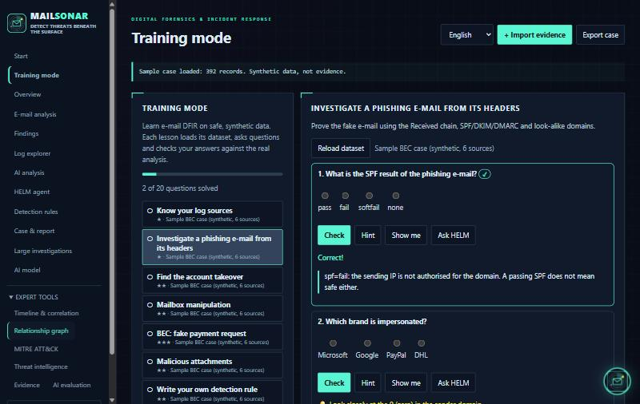
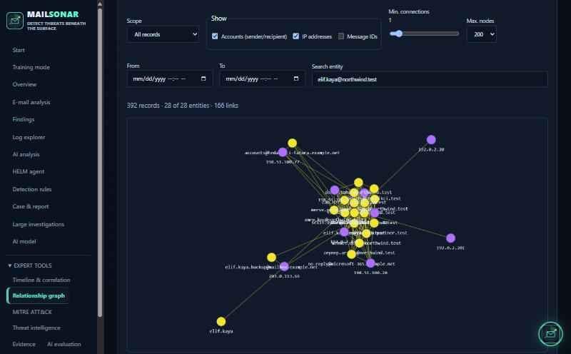
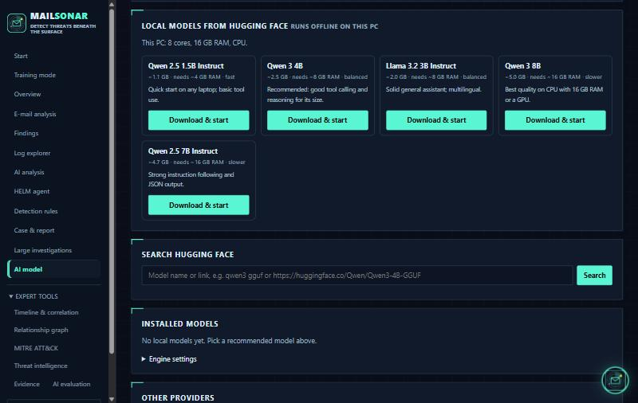

# MailSonar — V1.3

**Yüzeyin altındaki tehditleri bulun.** · 🇬🇧 [English README](README.md)

[](https://github.com/smyrna-pergamum/mailsonar/releases/latest)




MailSonar, e-posta adli bilişimi ve olay müdahalesi için yerel öncelikli bir çalışma tezgâhıdır (Rust + Tauri 2, sade JavaScript arayüz). Phishing, iş e-postası dolandırıcılığı (BEC), hesap ele geçirme, zararlı ekler ve veri sızıntısını; e-posta ağ geçidi, kimlik, posta kutusu denetimi, MTA ve ileti delillerinden inceler. Ayrıştırma, tespit ve korelasyon AI olmadan çalışır. **HELM** ajanı, yerel Hugging Face modelleriyle veya OpenAI uyumlu herhangi bir sağlayıcıyla delile dayalı AI analizi ekler.

> **Durum:** Kaynak kod Windows'ta derleniyor ve tüm testler geçiyor. Windows, Linux ve macOS kurulum dosyaları GitHub Actions ile üretiliyor. Bağımsız olarak doğrulanmış bir adli ürün değildir; ayrıntılar `TEST-RESULTS.md`, `SECURITY-AUDIT.md` ve `AI-EVALUATION.md` dosyalarında.

## İndirme

Son sürüm: **[v1.3.0](https://github.com/smyrna-pergamum/mailsonar/releases/latest)** (tüm sürümler: [Releases](https://github.com/smyrna-pergamum/mailsonar/releases)).

| Sistem | İndir |
|---|---|
| Windows 10/11 x64 | [Kurulum (.exe)](https://github.com/smyrna-pergamum/mailsonar/releases/download/v1.3.0/MailSonar_1.3.0_x64-setup.exe) · [MSI](https://github.com/smyrna-pergamum/mailsonar/releases/download/v1.3.0/MailSonar_1.3.0_x64_en-US.msi) |
| Linux x64 | [AppImage](https://github.com/smyrna-pergamum/mailsonar/releases/download/v1.3.0/MailSonar_1.3.0_amd64.AppImage) · [.deb](https://github.com/smyrna-pergamum/mailsonar/releases/download/v1.3.0/MailSonar_1.3.0_amd64.deb) · [.rpm](https://github.com/smyrna-pergamum/mailsonar/releases/download/v1.3.0/MailSonar-1.3.0-1.x86_64.rpm) |
| macOS Apple Silicon | [.dmg](https://github.com/smyrna-pergamum/mailsonar/releases/download/v1.3.0/MailSonar_1.3.0_aarch64.dmg) |
| macOS Intel | [.dmg](https://github.com/smyrna-pergamum/mailsonar/releases/download/v1.3.0/MailSonar_1.3.0_x64.dmg) |

- Kurulum dosyaları kod imzasız. macOS'ta ilk açılışta bir kez şu komut gerekir: `xattr -dr com.apple.quarantine /Applications/MailSonar.app`. Windows SmartScreen'de *Ek bilgi → Yine de çalıştır* seçilmelidir.
- Her paket, llama.cpp motorunun CPU sürümünü içerir. AI modelleri uygulama içinden indirilir.
- Aşağıdaki tüm özellikler (büyük vakalar, grafik filtreleri, VirusTotal bağlantıları, yeni derin analiz dahil) bu sürümde mevcuttur.

## Hızlı başlangıç

1. **Başla** → *Örnek BEC vakasını yükle* (sentetik) veya *Dosya içe aktar*.
2. **AI modeli** (isteğe bağlı) → *Bu bilgisayarda bulunanlar* listesinden bir model seçin. Bu liste çalışan Ollama, LM Studio, llama.cpp, vLLM, Jan… sunucularını ve diskteki GGUF dosyalarını gösterir. Alternatif olarak önerilen bir Hugging Face modelini *İndir ve başlat* ile kurun. *Bağlantıyı test et* sohbeti, hızı ve araç çağırmayı ölçer.
3. **AI analizi** → tek tıkla sorular veya kaydettiğiniz kendi sorgularınız.
4. **E-posta analizi** → başlıklar, Received zinciri, SPF/DKIM/DMARC, URL'ler ve ekler.
5. **Tespit kuralları** → kuralı doğal dille tarif edin.
6. **Eğitim modu** → örnek veri setleri üzerinde cevapları kontrol edilen, adım adım dersler.

Arayüz Türkçe, İngilizce ve Almanca'dır; dil menüsünden anında değiştirilebilir.

## Ekran görüntüleri

| | |
|---|---|
|  **E-posta analizi** — riske göre sıralı iletiler, SPF/DKIM/DMARC, Received zinciri, benzer alan adları, VirusTotal bağlantıları |  **AI analizi** — tek tıkla HELM profilleri, serbest soru, kayıtlı sorgular |
|  **Eğitim modu** — cevap kontrollü dersler |  **İlişki grafiği** — kapsam, varlık türü, zaman, bağlantı sayısı ve arama filtreleri |
|  **AI modeli** — yerel model keşfi, öz test, tek tıkla Hugging Face | |

Görüntüler, tarayıcı önizlemesinde sentetik örnek vakayla alınmıştır.

## Ekranlar

| Ekran | Ne işe yarar |
|---|---|
| **Başla** | Üç adım (delil → AI modeli → inceleme), log kaynakları ve e-posta sağlayıcıları, saldırı zincirleri |
| **Eğitim modu** | Sentetik BEC vakası ve depo veri seti üzerinde 9 ders ve 20 soru; ipucu, "ekranı göster", açıklama ve ilerleme takibi |
| **Genel bakış / Bulgular / Log gezgini** | Panolar, analist değerlendirmeli kural bulguları, sayfalı kayıt tarayıcı |
| **E-posta analizi** | Başlık, kimlik doğrulama, Received zinciri, URL, ek ve platform analiziyle riske göre sıralı iletiler |
| **AI analizi** | Dokuz tek tık inceleme profili (her biri bir HELM skill'i), serbest soru, **kayıtlı analist sorguları** ve seçilen kayıtlarla rehberli *derin analiz* (seçili, parça parça, iki aşamalı) |
| **HELM ajanı** | Canlı plan ve araç izli ajan konsolu, skill kütüphanesi, WAYPOINT iş akışları, oturumlar |
| **Tespit kuralları** | AI kural yazıcı (her kuralı vakaya karşı test eder), hızlı kural formu, JSON/Sigma/eşleme editörleri |
| **Vaka ve rapor** | Vaka kaydet/aç; HTML, PDF, JSON, OCSF ve ilişki grafiği dışa aktarımı |
| **Büyük vakalar** | Checkpoint, partiler arası korelasyon ve HELM ile milyonlarca olaylık vakalar |
| **AI modeli** | Yerel keşif ve öz test, Hugging Face merkezi, kurulu modeller, diğer sağlayıcılar |
| **Uzman araçları** | Zaman çizelgesi, filtreli ilişki grafiği, MITRE ATT&CK, tehdit istihbaratı, delil kasası, AI değerlendirmesi |

## E-posta adli analizi

- **İçe aktarma:** EML, MBOX, MSG, CSV, JSON, JSONL, XML, TXT, LOG, EVTX, XLSX, ZIP, GZIP.
- **İleti analizi** (statiktir; hiçbir şey çalıştırılmaz, açılmaz veya internetten sorgulanmaz):
  - **Received zinciri:** aşağıdan yukarıya okunur; kaynak IP, bilinmeyen aktarıcılar ve zaman sırası tutarsızlıkları bulunur.
  - **Kimlik doğrulama:** SPF, DKIM ve DMARC sonuçları.
  - **Gönderen tutarlılığı:** From, Return-Path, Reply-To ve görünen ad karşılaştırılır.
  - **Benzer alan adları:** homoglyph (ör. `micr0soft`), typosquatting ve marka kelimesi içeren alan adları.
  - **URL'ler:** görünen metin ile gerçek hedef farkı, punycode, kısaltıcılar, IP adresli bağlantılar, açık yönlendirmeler.
  - **Ekler:** SHA-256, dosya imzasına göre gerçek tür, çift uzantı, RTL karakter hilesi, makrolar, şifreli ZIP.
- **Log kaynağı ve e-posta sağlayıcı tespiti:** Her dosya; alan adları, ürün adları, satır biçimleri ve başlıklarla parmak izi çıkarılarak tanımlanır.
  - Tanınan kaynaklar: Microsoft 365 birleşik denetim logu, Exchange Online message trace, Entra ID oturumları, Exchange Server message tracking, Google Workspace, Postfix, Exim, Sendmail, Dovecot, Rspamd, Amavis, Proofpoint, Mimecast, Cisco Secure Email, Barracuda, Zimbra, Amazon SES.
  - İletilerde gönderen, aktarıcı, ağ geçidi ve alıcı platformları gösterilir: Microsoft 365, Gmail, SES, SendGrid, Mailgun, Proofpoint, Mimecast, GMX/WEB.DE, IONOS…
  - Her tespit, güven düzeyi ve gerekçesiyle birlikte verilir.
- **Elle itibar kontrolü:** Her URL, alan adı, kaynak IP ve ek hash'inin yanında bir *VT ↗* bağlantısı bulunur; VirusTotal'ı tarayıcınızda açar. Otomatik sorgu yapılmaz. İlk kullanımda, VirusTotal'ın üçüncü taraf olduğu konusunda bir kez uyarı gösterilir.
- **Tespit:** 30 yerleşik kural (MAIL-001…030), özel kurallar, Sigma alt kümesi, IOC eşleştirme, anomali kuralı.
- **Korelasyon:**
  - **COR-001:** kimlik doğrulama hatası penceresi.
  - **COR-002:** giden e-posta artışı.
  - **COR-003:** mesaj izi.
  - **COR-004:** hesap bazlı saldırı zinciri. 24 saat içinde şu sırayı arar: phishing alındı → şüpheli oturum → posta kutusu manipülasyonu → dolandırıcılık veya sızıntı.

## Büyük vakalar (milyonlarca olay)

Bellek içi çalışma alanı **100.000 kayda** kadar tutar. Daha büyük deliller **Büyük vakalar** ekranına gider; her vaka diskte bir SQLite deposu olarak saklanır.

- **Akışlı içe aktarma:**
  - CSV, JSONL/NDJSON, LOG/TXT ve MBOX satır satır okunur; GZIP ve ZIP içindekiler de dahil.
  - EML, JSON dizileri, EVTX, XLSX ve XML dosya başına 256 MiB'a kadar bellekte ayrıştırılır.
- **Parçalı işleme:**
  - Batch boyutu boş belleğe göre 2.000 ile 20.000 kayıt arasında ayarlanır.
  - 1–4 paralel işçi, sınırlı kuyruklarla çalışır (geri basınç).
  - Batch'ler sırayla yazılır ve her batch'te checkpoint alınır.
  - 20.000 sınırı bir batch'i sınırlar, vakanın toplam boyutunu değil.
- **Hata toleransı:**
  - Durdurulan veya çöken bir içe aktarma, aynı dosya (aynı SHA-256) yeniden eklendiğinde checkpoint'ten devam eder.
  - Birebir aynı olaylar bir kez saklanır (içerik hash'i).
  - Hatalı kayıtlar, kayıt numarasıyla birlikte ayrı bir tabloda tutulur.
- **Global korelasyon:** İçe aktarmadan sonra COR-001/002/003 ve COR-004 zinciri tüm batch'ler ve dosyalar üzerinde çalışır. Böylece 1. batch'teki bir phishing e-postası ile 40. batch'teki bir yönlendirme kuralı yine birbirine bağlanır.
- **Analiz:**
  - Özet ekranı: önem dağılımı, en sık varlıklar, saatlik etkinlik.
  - Sayfalı bulgular ve kayıtlar; alan bazlı veya tam metin arama.
  - Dosya başına log kaynağı profilleri.
  - **Tüm depo üzerinde HELM:** SQL tabanlı araçlar; bulut sağlayıcıya veriler takma adlarla gider.
  - *Sonuçları çalışma alanına kopyala:* seçilen sonuçlar bellek içi araçlarla incelenebilir.
- **Benchmark:** `cargo test --release --manifest-path src-tauri/Cargo.toml bench_ingest_scales -- --ignored --nocapture` komutu 1k–1M olayı ölçer: EPS, batch gecikmesi P50/P95/P99, tepe RAM, tekrarlar, hatalar, bütünlük ve çökme sonrası kurtarma. Sonuçlar `PERFORMANCE-BENCHMARKS.md` dosyasına yazılır.

## HELM ajanı ve skill'ler

HELM önce `update_plan` ile plan yapar, salt okunur araçlarla inceler, gerekirse skill yükler ve delil kimlikleriyle yanıt verir.

Araçlar:
- **Kayıtlar:** listeleme, filtreleme, arama, gruplama, zaman çizelgesi, e-posta izi.
- **Bulgular:** bulgu listesi, önem ve MITRE özetleri, IOC eşleşmeleri, delil inceleme.
- **Yeni araçlar:** `log_sources` (log kaynakları), `test_rule` (kural testi), `list_skills` / `load_skill` (skill listesi ve yükleme).
- **Diğer:** vaka özeti, rapor taslağı (rapor taslağı için analist onayı gerekir).

**Skill'ler**, Claude Code, Codex ve OpenCode'daki skill'ler gibi Markdown kılavuzlarıdır:

```markdown
---
name: phishing-triage
description: HELM bu skill'i ne zaman kullanmalı
triggers: phishing, oltalama, spoof
preload:
  - findings {"severity": "high", "limit": 25}
---
# Kılavuz: adımlar ve yanıt biçimi
```

- **10 yerleşik skill:** triage, phishing-triage, email-header-forensics, malware-delivery, account-takeover, mailbox-rule-abuse, bec-fraud, data-exfiltration, detection-engineering, incident-report.
- **Kendi skill'inizi ekleme:** **Skill'ler** sekmesinde yeni bir skill yazabilir, yerleşik bir skill'i kopyalayıp düzenleyebilir veya **`.md` dosyası içe aktarabilirsiniz**. Bu skill'ler `<uygulama verisi>/skills/` klasöründe saklanır ve aynı adlı yerleşik skill'in yerine geçer.
- **Skill seçimi:** Bir skill'i zorlamak için mesaja `/skill-adı` ile başlayın. Aksi hâlde HELM tetikleyici kelimelere göre seçer ve gerektiğinde skill'i kendisi yükler.
- **Ön yükleme:** `preload` araçları model ilk turunu yapmadan önce arka uçta çalışır; böylece küçük yerel modeller de gerçek veriden başlar.
- **Araç çağırma:** Yerel fonksiyon çağırma desteklenir; desteklemeyen modeller için metin protokolü (`<tool_call>{…}</tool_call>`) kullanılır.
- **Takip soruları:** Önceki sorular sınırlı bir geçmişle hatırlanır (yalnızca yerel sağlayıcılarda). Ajan adımları canlı izlenir.
- **Güvenlik sınırı:** Skill'ler araç veya yetki ekleyemez ve veri küçültmeyi devre dışı bırakamaz.

## Yerel AI

- **Bu bilgisayarda bulunanlar:**
  - Ollama, LM Studio, llama.cpp, vLLM, KoboldCpp, text-generation-webui, Jan, GPT4All ve LocalAI için yerel portlar yoklanır.
  - LM Studio, Hugging Face önbelleği, Jan, GPT4All, `~/models` ve İndirilenler klasörlerinde GGUF dosyaları taranır.
- **Öz test:** Yalnızca sentetik istemler kullanılır. Sohbet, gecikme, token/sn, yerel veya metin tabanlı araç çağırma ve HELM'e hazır olup olmadığı raporlanır.
- **Hugging Face:**
  - Önerilen modeller *İndir ve başlat* ile tek tıkta kurulur. Listeden tek dosyalı Q4_K_M sürümü seçilir; yayımlanmışsa SHA-256 doğrulanır.
  - Arama yapabilir veya depo bağlantısını yapıştırabilirsiniz.
- **Dahili motor:**
  - llama.cpp `llama-server` CPU sürümü kullanılır. Yerel adreste, her çalıştırmada değişen bir anahtarla ve `--jinja` ile başlar.
  - Yerel çalışan düşünme modelleri için "thinking" kapatılır.
  - Bağlam penceresi taşarsa, toplanan kanıtla final yanıt üretilir.
  - Ölçüm: 8 çekirdekli bir dizüstü CPU'da Qwen3-4B Q4_K_M ile yaklaşık 3,5 token/sn; ajan turu başına 1–9 dakika.
  - Etkileşimli hız için GPU sürümü, daha küçük bir model veya harici bir sunucu kullanın.

## AI gizlilik modeli

- Tüm AI özellikleri tek bir AI bağlantısını paylaşır.
- Yerel (loopback) sağlayıcılarda her şey cihazda kalır.
- Uzak sağlayıcılarda her çalıştırma öncesinde, adresi yazılı bir onay istenir.
- Uzak sağlayıcılara giden verilerde:
  - Gönderen, alıcı, IP ve mesaj kimliği `entity-N` takma adlarıyla değiştirilir.
  - Ham kayıt verisi ve kaynak adları çıkarılır.
  - IOC değerleri ve bulgu ayrıntıları gizlenir.
  - Konuşma geçmişi iletilmez.
- Bu bir takma adlandırmadır, tam anonimleştirme değildir. Sorular ve notlar yazıldığı gibi gönderilir. API anahtarları yalnızca bellekte tutulur.

## Sınırlar

- Bellek içi çalışma alanı: 100.000 kayıt ve dosya başına 64 MiB. Daha büyük deliller için Büyük vakalar kullanılır (bu bilgisayarda SQLite; dağıtık küme yoktur).
- MSG dosyalarında yalnızca seçili MAPI özellikleri okunur. Ekler hash'lenir ve statik incelenir; sandbox, antivirüs veya itibar sorgusu yoktur.
- Sağlayıcı tespiti sezgiseldir. Yeniden adlandırılmış veya yeniden dışa aktarılmış loglar başka bir ürün gibi görünebilir.
- HELM sınırlı bir tek ajan döngüsüdür. AI çıktısı doğrulanmamıştır ve analist incelemesi gerektirir.
- Linux ve macOS paketleri CI'da üretilir; elle test edilmemiştir.

## Kaynaktan derleme

Gereksinimler:
- Rust stable ve Node.js 22+.
- Tauri 2 platform gereksinimleri:
  - Windows: VS C++ Build Tools ve WebView2.
  - Linux: `libwebkit2gtk-4.1-dev libappindicator3-dev librsvg2-dev patchelf`.

```sh
npm install
npm test
cargo test --manifest-path src-tauri/Cargo.toml
npm run tauri dev      # geliştirme
npm run tauri build    # kurulum dosyaları: src-tauri/target/release/bundle
```

- Tarayıcı önizlemesi (`npm run dev`), örnek veri setlerinin gerçek ayrıştırıcı çıktısını `tests/fixtures` klasöründen sunar; model çıkarımı yapmaz.
- Gerçek bir modelle uçtan uca test için:

```powershell
$env:MAILDFIR_TEST_GGUF = "C:\model\yolu\model.gguf"
cargo test --manifest-path src-tauri/Cargo.toml demo_helm_with_real_model -- --ignored --nocapture
```

## Sürümler (GitHub Actions)

- `.github/workflows/release.yml`, `tauri-apps/tauri-action` ile Windows x64, Linux x64, macOS arm64 ve macOS x64 paketlerini derler. Her pakete uygun llama.cpp motoru eklenir ve dosyalar **taslak** bir release'e yüklenir.
- Başlatmak için bir etiket gönderin (`git tag v1.3.0 && git push origin v1.3.0`) veya *Actions → Release → Run workflow* kullanın.
- `.github/workflows/ci.yml` her push'ta testleri, clippy kontrolünü ve Windows derlemesini çalıştırır.

## Proje yapısı

```
src/                    Arayüz (JS): main.js, ui/ (başla, eğitim, e-posta, AI, kurallar, model merkezi,
                        skill'ler, büyük vakalar, grafik filtreleri)
src-tauri/src/          Rust arka uç: ayrıştırma, email.rs, sources.rs, agent.rs (HELM), skills.rs,
                        local_ai.rs, embedded_ai.rs, inv_*.rs (büyük vakalar), lookup.rs, samples.rs
src-tauri/skills/       Yerleşik HELM skill'leri (Markdown)
samples/demo/           Sentetik BEC vakası (dataset/generators/demo_scenario.py)
dataset/                Etiketli çok kaynaklı veri seti, üreticiler ve doğruluk verisi
docs/screenshots/       README ekran görüntüleri
tests/                  Node ve Python testleri, önizleme verileri
```

## Belgeler

`CHANGELOG.md` · `ROADMAP.md` · `TEST-RESULTS.md` · `SECURITY-AUDIT.md` · `AUDIT.md` · `AI-EVALUATION.md` · `AI-QUALITY-GATES.md` · `MODEL-BENCHMARKS.md` · `PERFORMANCE-BENCHMARKS.md` · `DATASET-MANIFEST.md` · `TRACEABILITY.md` · `THIRD-PARTY-NOTICES.md`

Uygulama kimliği `org.maildfir.desktop`, depolama yolları ve vaka şema kimlikleri eski adlarını korur; böylece mevcut kurulumlar yerinde güncellenir.

## Lisans

`LICENSE` ve `THIRD-PARTY-NOTICES.md` dosyalarına bakın.
